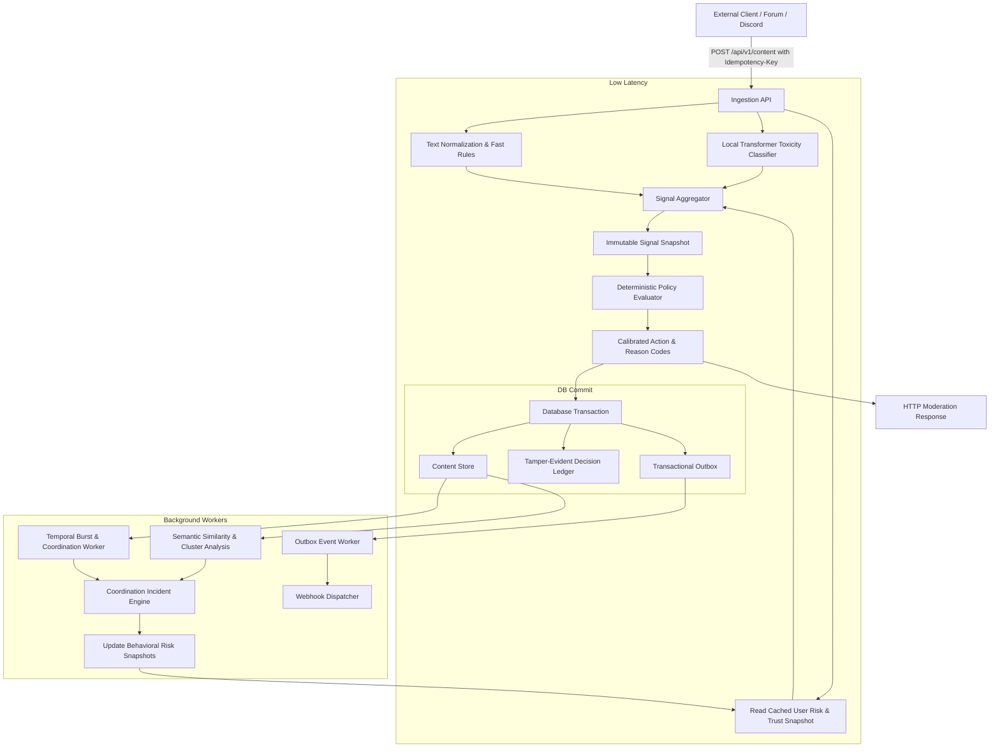

# Shhmods: Adaptive & Explainable Moderation Decision Engine

Shhmods is an open-source, self-hosted moderation decision engine designed to detect coordinated abuse, adapt enforcement to risk, and make automated decisions auditable, appealable, and counterfactually testable.

Rather than acting as another generic classification wrapper, Shhmods combines **behavioral signals**, **temporal coordination graph analytics**, and **deterministic policy evaluation** to distinguish isolated rule violations from organized campaigns without over-censoring innocent users.

---

## The Core Problem

Traditional content moderation suffers from three fundamental failure modes:

1. **Context Blindness & Over-Enforcement:** Standalone toxicity classifiers score text in isolation, frequently punishing legitimate users for quoting, reclaimed slang, sarcasm, or heated but non-coordinated disagreements.
2. **Evasion by Distributed Swarms:** Organized attackers bypass keyword filters and per-account rate limits by rotating accounts, paraphrasing text, and coordinating bursts across multiple targets.
3. **Opaque & Irreversible Enforcement:** Decisions made by third-party black-box APIs or brittle rules are difficult to debug, audit, or appeal. Administrators cannot simulate policy changes before deploying them to live communities.

---

## Core Principles

- **Moderate behavior, not just text:** An isolated offensive term from a veteran user requires different handling than a synchronized swarm of new accounts targeting a single individual.
- **Apply least-restrictive enforcement:** Enforcement actions reflect risk and uncertainty (`ALLOW`, `ALLOW_WITH_MONITORING`, `RATE_LIMIT`, `REVIEW`, `BLOCK`, `ESCALATE`) rather than binary permanent punishments.
- **Make every decision explainable, reversible, and measurable:** Every decision records an immutable snapshot of all active signals at evaluation time. Erroneous decisions can be reversed on appeal, and policies can be counterfactually simulated against historical traffic.

---

## Architecture: Fast Path vs. Analytical Path

Shhmods separates the latency-critical synchronous decision path from asynchronous behavioral and graph analytics to ensure responsive throughput under load.



---

## Distinctive Features

### 1. Multidimensional Behavioral Trust with Uncertainty
- **Behavior-Specific Dimensions:** Tracks standing independently across `spam`, `harassment`, `coordination`, and `general_abuse`. A user with a clean record who slips in an argument is not treated the same as an affiliate spammer.
- **Uncertainty & Evidence Counts:** Distinguishes new accounts (high uncertainty, low evidence) from established accounts (calibrated confidence).
- **Distinguishing Decay from Sustained Good Behavior:** Penalties decay with time, but privilege restoration requires demonstration of sustained legitimate participation, preventing abusive accounts from recovering simply by idling.

### 2. Coordination Detection Without Identical Payloads
- **Beyond Hash Matching:** Attackers easily evade exact-match hashing by changing words or punctuation.
- **Multi-Signal Graph Clusters:** Evaluates temporal bursts, paraphrased semantic similarity, shared target concentration, and account creation patterns.
- **Structured Campaign Evidence:** Decisions return explicit, interpretable evidence (e.g., `18 accounts targeted victim X within 40s with 85% semantic alignment`) instead of opaque flags.

### 3. Deterministic Policy Replay & Counterfactual Simulation
- **Decoupled Signals and Policies:** Evaluated signals are stored as immutable snapshots alongside each decision.
- **Pre-Deployment Policy Testing:** Administrators can replay historical datasets against candidate rules to evaluate false positive reduction, detection recall, and moderator review queue impact before applying changes live.

### 4. Reversible Enforcement & Human-in-the-Loop Appeals
- **Proportionate Actions:** Supports non-destructive actions including `ALLOW_WITH_MONITORING`, temporary `RATE_LIMIT`, and `REVIEW` hold queues.
- **Audit & Appeal Loop:** Overturned decisions restore trust standing and flag the historical evidence as contested, ensuring erroneous automated findings do not permanently poison user history.

### 5. Local Multi-Label Transformer Classification
- **Self-Hosted Inference:** Powered by **Microsoft ONNX Runtime** in Java with a pre-trained multi-label transformer (`unitary/toxic-bert`) and pure-Java WordPiece tokenization.
- **Model Abstention:** Classifiers output calibrated probabilities across 6 labels (`toxic`, `severe_toxic`, `obscene`, `threat`, `insult`, `identity_hate`). Ambiguous or low-confidence predictions automatically route to human review rather than executing automated sanctions.

---

## Integration Example

Shhmods operates as a headless Moderation-as-a-Service API. It uses tenant-scoped external IDs and requires **zero personal identifiable information (PII)**:

### 1. Content Submission with Idempotency
```http
POST /api/v1/content
Content-Type: application/json
Idempotency-Key: req_msg_98412491

{
  "tenantId": "gaming_forum",
  "externalUserId": "discord_84920194",
  "username": "community_member",
  "contentText": "Check out this link: http://example.com/item",
  "contentType": "FORUM_POST"
}
```

### 2. Structured Decision Response
```json
{
  "decision": "REVIEW",
  "reason": "Untrusted account posted external URL under high temporal burst",
  "reasonCodes": ["UNTRUSTED_USER_URL", "TEMPORAL_BURST_ELEVATED"],
  "signals": {
    "accountAgeDays": 1.2,
    "spamTrust": 45.0,
    "coordinationRisk": 0.68,
    "onnxToxicityScore": 0.04
  },
  "riskSnapshot": {
    "version": 420,
    "freshnessSeconds": 2
  }
}
```

---

## Adversarial Evaluation Lab

Shhmods includes a benchmark harness to empirically compare moderation architectures against controlled workloads:

### Evaluated Baselines:
1. **Baseline A:** Keyword & Regex Filter
2. **Baseline B:** Keyword Filter + Per-Account Token Bucket Rate Limiting
3. **Baseline C:** Supervised Toxicity Classifier + Rate Limiting
4. **Baseline D:** Shhmods 2.0 (Multidimensional Trust + Coordination Graph + Calibrated Policy)

### Evaluation Scenarios:
- **Legitimate High-Volume Event:** Synchronized benign discussion (measures false positive resistance).
- **Isolated Violations:** Single toxic comments (measures classification precision & least-restrictive enforcement).
- **Account-Rotating Spam:** Distributed spam staying below individual rate limits (measures behavioral clustering).
- **Paraphrased Swarm Attack:** Coordinated harassment with non-identical text (measures multi-signal campaign detection).

Run the comparative benchmark:
```bash
python3 scripts/benchmark.py --scenarios all --compare-baselines
```

---

## Quickstart & Local Setup

### Prerequisites
- **Docker & Docker Compose**
- **Java 21 (JDK)**
- Python 3.9+ with `requests` (for benchmark suite)

### 1. Setup Models
Download the ONNX transformer model and tokenizer vocabulary:
```bash
./scripts/download_models.sh
```

### 2. Build & Verify
Run tests and build the application artifact:
```bash
./gradlew test
./gradlew build
```

### 3. Launch Services
Start PostgreSQL, the Spring Boot engine, and the Admin UI:
```bash
docker compose up -d --build
```
- **Backend API:** `http://localhost:8080`
- **Interactive Moderation Debugger (UI):** `http://localhost:80`

